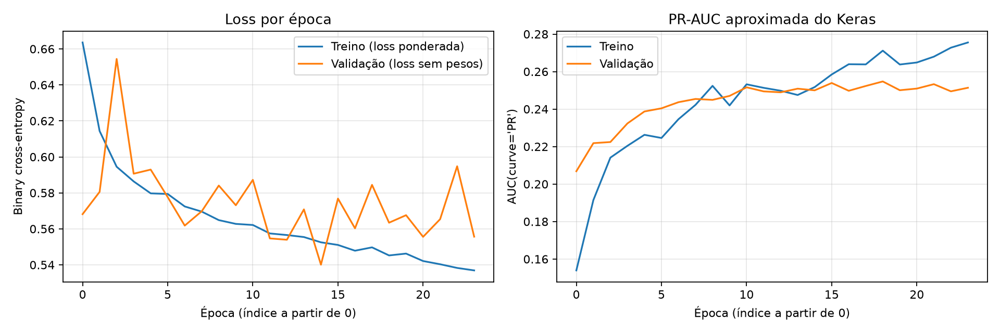
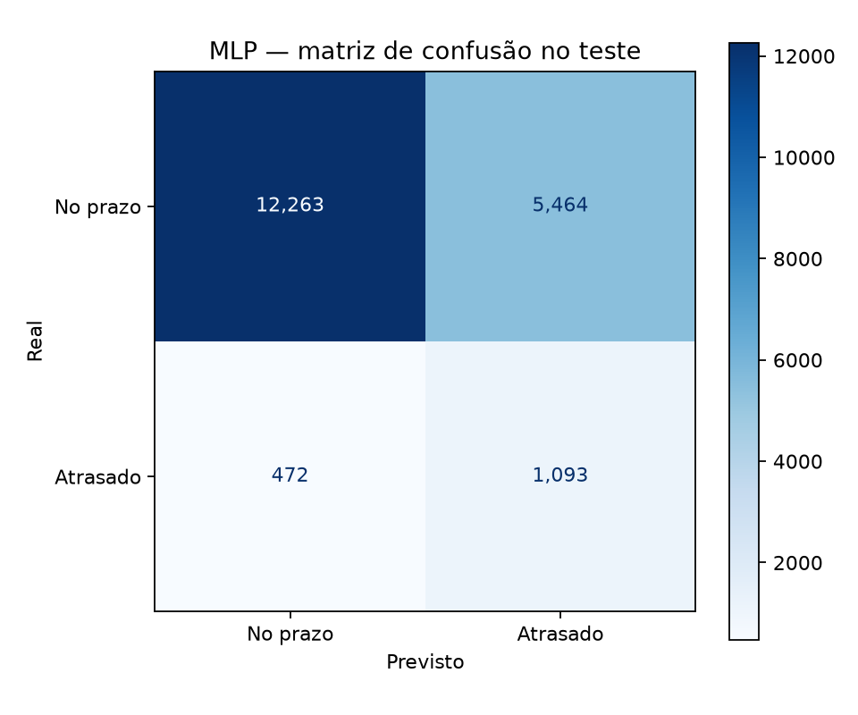

# Deep Learning — redes neurais com TensorFlow e Keras

Projeto de estudo de redes neurais, desde o cálculo de uma saída com pesos fixos até o treinamento de uma **MLP para previsão de atrasos em pedidos da Olist**.

A aplicação principal é executada por módulos Python. Os notebooks complementam o estudo com forward pass, gradientes, otimização, regularização e classificação de imagens do CIFAR-10.

[Voltar ao repositório principal](../README.md)

## Objetivos

- Compreender o papel dos pesos, bias, funções de ativação e função de perda.
- Relacionar o cálculo de gradientes à atualização dos parâmetros.
- Aplicar uma rede densa a dados tabulares desbalanceados.
- Separar treino, validação e teste e ajustar o pré-processamento apenas no treino.
- Acompanhar o treinamento, selecionar um checkpoint e analisar erros e alertas falsos.
- Explorar CNNs em notebooks complementares.

## Dados e relação com o projeto Olist

A MLP utiliza a base refinada produzida pelo [projeto Olist](../olist/README.md):

```text
olist/data/interim/orders_dataset_refined.csv
```

São **96.456 pedidos**, com uma linha por pedido e aproximadamente **8,11% de atrasos**. O alvo `is_late` indica se a entrega efetiva ocorreu após o timestamp estimado, conforme a regra documentada no projeto Olist.

As 14 variáveis de entrada incluem prazo prometido, tempo de aprovação, quantidade de itens e vendedores, preços, frete, relações entre valores, momento da compra e estado do cliente. A data de entrega efetiva não é utilizada como atributo preditivo.

O arquivo refinado **não está incluído no Git**. Ele deve ser gerado pelo projeto Olist ou fornecido pelo argumento `--data`. As duas pastas utilizam ambientes independentes; a integração é feita pelo CSV, sem importar o pacote Python da Olist.

## Separação e pré-processamento

A divisão é estratificada pelo alvo, com semente **42**:

| Conjunto | Proporção aproximada | Pedidos |
|---|---:|---:|
| Treino | 60% | 57.873 |
| Validação | 20% | 19.291 |
| Teste | 20% | 19.292 |

O pré-processador é ajustado somente no treino:

| Tipo de variável | Tratamento |
|---|---|
| Numérica | Imputação pela mediana e padronização com `StandardScaler`. |
| Categórica | Preenchimento de ausências e one-hot encoding, ignorando categorias novas na transformação. |

Hora, dia da semana, mês e estado são tratados como categóricos. Após a transformação, as entradas são convertidas para `float32`. Na execução registrada, a rede recebeu **80 atributos transformados**.

O arquivo [mlp_splits.csv](reports/mlp_splits.csv) registra os identificadores dos pedidos e suas partições.

## Arquitetura da MLP

| Etapa | Configuração |
|---|---|
| Entrada | Atributos após o pré-processamento. |
| Bloco denso 1 | Dense de 128 unidades → Batch Normalization → ReLU → Dropout de 0,30. |
| Bloco denso 2 | Dense de 64 unidades → Batch Normalization → ReLU → Dropout de 0,30. |
| Saída | Uma unidade com ativação sigmoid. |
| Otimizador | Adam, taxa de aprendizado de 0,001. |
| Perda | Binary Cross-Entropy com pesos de classe durante o treino. |
| Lote | 256 pedidos. |
| Limite de treinamento | 100 épocas. |
| Seleção do checkpoint | Maior `val_pr_auc`. |
| Parada antecipada | Cinco épocas sem melhora de `val_pr_auc`, com restauração dos melhores pesos. |
| Limiar de classificação | 0,50, fixo e não otimizado no teste. |

Os pesos das classes são calculados a partir das frequências no treino. Na execução registrada, foram aproximadamente **0,5442** para a classe sem atraso e **6,1619** para a classe com atraso.

O treinamento utiliza `tf.data.Dataset`, com embaralhamento dos exemplos de treino e limites na fila de entrada para execução em computadores com poucos recursos.

## Treinamento registrado

A execução utilizou **Python 3.12.16**, **TensorFlow 2.21.0** e **Keras 3.15.1**.

- Épocas solicitadas: **100**.
- Épocas executadas: **24**.
- Melhor época pela métrica de validação: **19**.
- Avaliação realizada com o checkpoint salvo dessa época.



A métrica `pr_auc` do Keras é uma aproximação da área sob a curva precisão-recall. Ela não é numericamente equivalente à Average Precision calculada pelo scikit-learn no relatório de teste.

A perda de treino recebe pesos de classe, enquanto a perda de validação não recebe esses pesos. Além disso, Dropout atua no treino. Portanto, a diferença entre as perdas não deve ser interpretada isoladamente como evidência de overfitting.

Metadados completos: [mlp_metadata.json](models/mlp_metadata.json). Histórico por época: [mlp_history.json](reports/mlp_history.json).

## Resultados no teste

Resultados em **19.292 pedidos**, com limiar **0,50**:

| Métrica | Valor |
|---|---:|
| Acurácia | 69,23% |
| Precisão | 16,67% |
| Recall | 69,84% |
| F1 | 0,2691 |
| ROC-AUC | 0,7628 |
| Average Precision | 0,2398 |

| Resultado da classificação | Pedidos |
|---|---:|
| Atrasos identificados | 1.093 |
| Atrasos não identificados | 472 |
| Alertas falsos | 5.464 |
| Pedidos sem atraso classificados corretamente | 12.263 |



A rede identificou uma parcela relevante dos atrasos, com um volume elevado de alertas falsos. Uma previsão constante de ausência de atraso alcançaria **91,89% de acurácia**, mas recall zero para atrasos. Por isso, a análise considera várias métricas, não apenas a acurácia.

Relatório completo: [mlp_test_metrics.json](reports/mlp_test_metrics.json).

### Relação com os resultados do XGBoost

No experimento Olist, o XGBoost com limiar 0,14 apresentou AP de 0,2662, recall de 45,69% e 2.042 alertas falsos. A MLP apresentou AP de 0,2398, recall de 69,84% e 5.464 alertas falsos.

A comparação é descritiva: além da arquitetura, mudam o tamanho do conjunto utilizado no ajuste, o uso de pesos de classe e o critério de decisão. O maior recall da MLP, isoladamente, não demonstra superioridade geral sobre o XGBoost.

**O conjunto de teste já havia sido utilizado no projeto Olist.** Esta avaliação não representa um teste final inédito e não deve ser usada para retunar a rede ou seu limiar.

## Notebooks de estudo

| Notebook | Conteúdo |
|---|---|
| [atividade_tensorflow.ipynb](notebooks/atividade_tensorflow.ipynb) | Forward pass com seis pedidos hipotéticos, pesos fixos, ReLU, sigmoid, limiar e Binary Cross-Entropy. Rede 3 → 4 → 1 com 21 parâmetros, sem treinamento. |
| [Treinamento_redes_neurais_keras.ipynb](notebooks/Treinamento_redes_neurais_keras.ipynb) | Gradientes com `GradientTape`, taxas de aprendizado, treinamento com Keras, comparações na validação, regularização e leitura dos resultados da MLP salva. |
| [Classificador_Imagens-v1.ipynb](notebooks/Classificador_Imagens-v1.ipynb) | CNN inicial para CIFAR-10, com filtros 16 → 32 → 64, treinamento e análise de erros. |
| [Classificador_Imagens-v2.ipynb](notebooks/Classificador_Imagens-v2.ipynb) | CNN com mais filtros, aumento de dados, Batch Normalization, Dropout, L2 e Global Average Pooling. |

Os exemplos hipotéticos não são registros reais da Olist. As comparações dos notebooks são estudos próprios e não substituem automaticamente o checkpoint da MLP modular.

Os dois notebooks CIFAR-10 reservam **20% das imagens oficiais de treino para validação** e salvam artefatos em `models/notebooks/` e `reports/notebooks/`. Esses protocolos são diferentes do projeto [Visão Computacional](../visao_computacional/README.md), que usa 10% para validação e outra configuração da segunda CNN. Os resultados daquele projeto não devem ser atribuídos a estes notebooks.

Os relatórios locais dos estudos complementares não estão incluídos na versão publicada consultada. Os resultados numéricos apresentados neste README correspondem à MLP modular.

## Instalação e execução

Pré-requisitos: **Python 3.12.x**, **uv** e a base refinada da Olist. Partindo da raiz do repositório:

```powershell
cd deep_learning
uv sync
```

Confirme a existência de `../olist/data/interim/orders_dataset_refined.csv` antes do treinamento. Consulte o [README da Olist](../olist/README.md) para gerar essa base no ambiente daquele projeto.

### Treinamento pelo módulo principal

```powershell
uv run python -m module_deep_learning.main
```

Para informar outro arquivo:

```powershell
uv run python -m module_deep_learning.main --data "C:/dados/orders_dataset_refined.csv"
```

Para definir outro limite de épocas:

```powershell
uv run python -m module_deep_learning.main --epochs 20
```

O argumento altera o limite de épocas, sem remover a parada antecipada. O módulo principal **executa treinamento** e pode sobrescrever modelos e relatórios; não é necessário executá-lo novamente para consultar os resultados salvos.

### Execução dos notebooks

Selecione o Python da `.venv` de `deep_learning` no editor. Para registrar um kernel com nome próprio:

```powershell
uv run python -m ipykernel install --user --name module-deep-learning --display-name "Python (deep_learning)"
```

A primeira carga do CIFAR-10 pode exigir download. As células de treinamento dos notebooks ajustam novas redes e podem demorar em CPU.

## Artefatos salvos

| Arquivo | Conteúdo |
|---|---|
| [mlp_olist.keras](models/mlp_olist.keras) | Checkpoint da rede selecionada pela validação. |
| [mlp_preprocessor.joblib](models/mlp_preprocessor.joblib) | Imputação, escala e codificação ajustadas no treino. |
| [mlp_metadata.json](models/mlp_metadata.json) | Arquitetura, configuração, pesos de classe, versões e identificação da base. |
| [mlp_history.json](reports/mlp_history.json) | Métricas por época. |
| [mlp_splits.csv](reports/mlp_splits.csv) | Associação entre pedidos e partições. |
| [mlp_test_metrics.json](reports/mlp_test_metrics.json) | Métricas e matriz de confusão no teste. |
| `reports/figures/` | Curvas de treinamento e matriz de confusão. |

Para aplicar o checkpoint a novos dados, é necessário reutilizar o **pré-processador salvo**, respeitar as 14 entradas esperadas e manter a ordem produzida pela transformação. Não basta carregar somente o arquivo Keras.

## Organização do código

| Módulo | Responsabilidade |
|---|---|
| `config.py` | Caminhos, semente e hiperparâmetros. |
| `dataset.py` | Leitura e validação da base refinada. |
| `features.py` | Pré-processamento e transformação dos atributos. |
| `split.py` | Separação de treino, validação e teste. |
| `modeling/model.py` | Construção e compilação da MLP. |
| `modeling/train.py` | Lotes, pesos de classe, callbacks e treinamento. |
| `modeling/evaluate.py` | Métricas e comparação com a classe majoritária. |
| `plots.py` | Gráficos da execução. |
| `main.py` | Orquestração, salvamento e avaliação. |

Os caminhos da tabela são relativos a `module_deep_learning/`.

## Limitações

A divisão aleatória por pedido não simula previsão de períodos futuros nem separa clientes entre partições. A rede foi avaliada em um conjunto já consultado e os escores não foram calibrados como probabilidades operacionais.

Os pesos de classe e o limiar escolhido influenciam o equilíbrio entre identificação de atrasos e alertas falsos. Usar a solução para decisões reais exigiria considerar os custos desses erros e validar o desempenho em novos dados.

## Autoria e licença

**Rafael Athaliba — SENAI CIMATEC.** Código sob a licença indicada em [LICENSE](LICENSE). Bases de dados e modelos de terceiros possuem condições de uso próprias.
