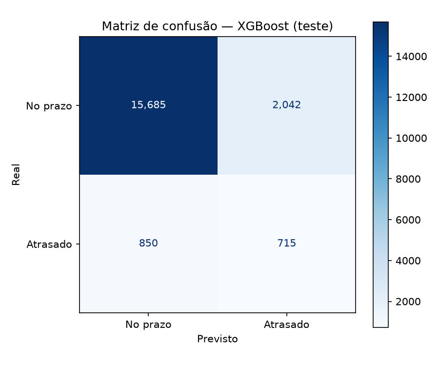
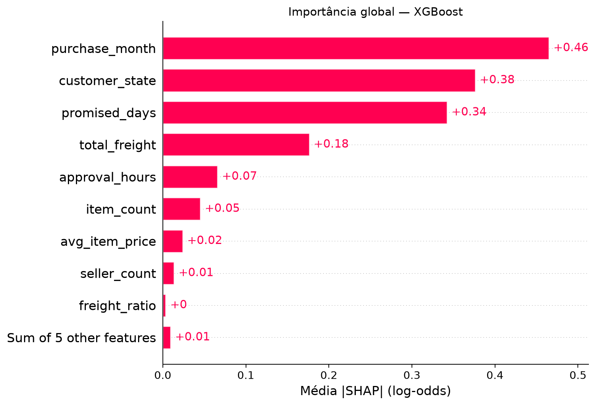
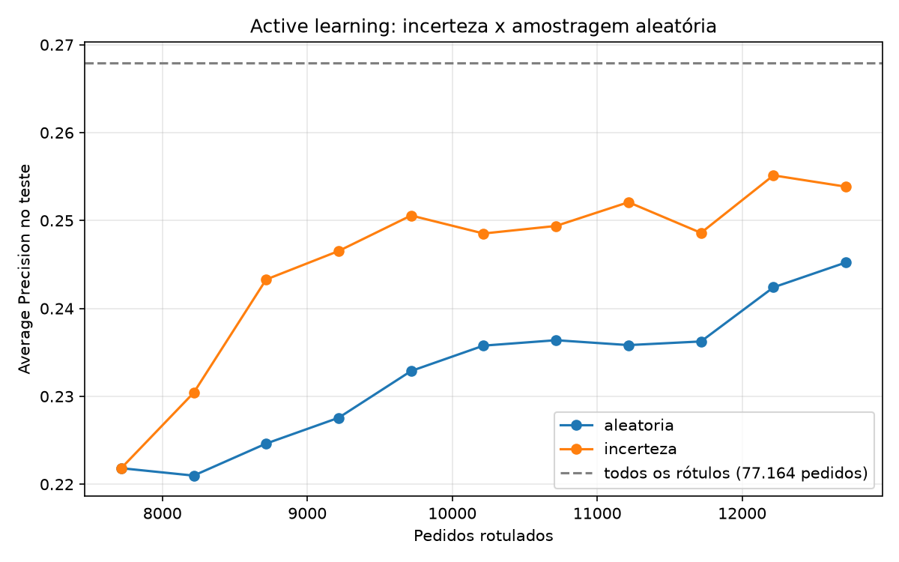

# Olist — previsão de atrasos em pedidos

Projeto de classificação para identificar pedidos com maior escore de atraso na entrega, a partir de informações do pedido, do prazo e da aprovação do pagamento.

O trabalho inclui análise de qualidade dos dados, exploração, engenharia de atributos, comparação de modelos, inferência em pedidos abertos, explicações SHAP e uma simulação de active learning.

[Voltar ao repositório principal](../README.md)

## Dados e definição do problema

São utilizadas três tabelas do conjunto **Brazilian E-Commerce Public Dataset by Olist**:

| Arquivo | Informações utilizadas |
|---|---|
| `olist_orders_dataset.csv` | Status e datas dos pedidos. |
| `olist_order_items_dataset.csv` | Itens, vendedores, preços e fretes. |
| `olist_customers_dataset.csv` | Estado do cliente e chave para integração. |

A base de modelagem possui **uma linha por pedido**. Os itens são agregados antes da integração com pedidos e clientes.

Para construir o alvo, são selecionados pedidos com status `delivered` e datas preenchidas de aprovação, entrega ao cliente e entrega estimada. O alvo `is_late` recebe:

- **1:** entrega ao cliente posterior à data estimada.
- **0:** entrega ao cliente anterior ou igual à data estimada.

A comparação utiliza **timestamps completos**. Uma entrega no dia estimado, após 00:00, pode ser classificada como atrasada. Essa convenção foi mantida ao longo do experimento; uma interpretação do prazo como dia inteiro exigiria revisar o alvo e repetir as análises.

O recorte final contém **96.456 pedidos**, com aproximadamente **8,11% de atrasos**. O estudo trata atraso entre pedidos entregues, não cancelamentos ou a probabilidade de um pedido chegar a ser entregue.

## Etapas do projeto

| Etapa | Implementação |
|---|---|
| Qualidade dos dados | [Notebook de qualidade](notebooks/01_data_quality.ipynb) e relatórios auxiliares. |
| Análise exploratória | [Notebook de EDA](notebooks/02_EDA.ipynb). |
| Engenharia de atributos | [Notebook de features](notebooks/03_feature_engineering.ipynb) e funções no módulo Python. |
| Modelagem | Pipelines com Gradient Boosting, XGBoost e LightGBM. |
| Validação | Cinco folds estratificados e seleção do limiar com predições fora do fold. |
| Inferência | Ranking dos pedidos abertos observados nos CSVs. |
| Explicabilidade | SHAP global e explicações locais de pedidos na faixa alta. |
| Active learning | Simulação de seleção por incerteza comparada à seleção aleatória. |

## Atributos utilizados

As entradas foram concebidas para representar informações disponíveis até a aprovação do pagamento. Datas de entrega efetiva não são usadas como atributos preditivos.

| Grupo | Atributos |
|---|---|
| Prazo e aprovação | `promised_days`, `approval_hours`, `is_short_deadline`. |
| Composição do pedido | `item_count`, `seller_count`, `total_price`, `total_freight`. |
| Relações entre valores | `avg_item_price`, `freight_ratio`. |
| Momento da compra | `purchase_hour`, `purchase_weekday`, `purchase_month`, `is_weekend_purchase`. |
| Localização | `customer_state`. |

Prazos não positivos e resultados inconsistentes de cálculos ficam ausentes para tratamento pelo pipeline. As colunas numéricas recebem imputação pela mediana; as categóricas recebem uma categoria para ausências e codificação one-hot. Hora, dia da semana, mês e estado são tratados como categóricos.

Os parâmetros de imputação e as categorias são aprendidos apenas na partição de ajuste, inclusive dentro de cada fold da validação cruzada.

## Validação e seleção

A divisão inicial é aleatória e estratificada pelo alvo, com semente 42:

| Partição | Pedidos |
|---|---:|
| Treino | 77.164 |
| Teste | 19.292 |

No treino, os três modelos são comparados com `StratifiedKFold` de **cinco folds**. Cada pedido recebe uma predição out-of-fold (OOF), obtida por um modelo que não foi ajustado naquele pedido.

Para cada modelo, são testados limiares de **0,01 a 0,99**, em incrementos de 0,01. O critério de seleção é o **maior F1 OOF após a escolha do limiar**. Em seguida, o modelo selecionado é ajustado em todo o treino.

| Modelo | Limiar selecionado | F1 OOF de seleção | Average Precision média nos folds |
|---|---:|---:|---:|
| XGBoost | 0,14 | 0,3300 | 0,2682 |
| LightGBM | 0,14 | 0,3288 | 0,2684 |
| Gradient Boosting | 0,14 | 0,3283 | 0,2666 |

O **XGBoost** foi escolhido pelo F1 OOF, não pela maior Average Precision média. O F1 usado para escolher modelo e limiar é uma medida de seleção, não uma estimativa independente de desempenho.

Detalhes: [comparação dos modelos](reports/cv_results.csv), [métricas por fold](reports/cv_folds.csv) e [busca de limiares](reports/cv_thresholds.csv).

## Resultados no teste

Resultados do XGBoost com limiar **0,14**, em 19.292 pedidos:

| Métrica | Valor |
|---|---:|
| Acurácia | 85,01% |
| Precisão | 25,93% |
| Recall | 45,69% |
| F1 | 0,3309 |
| ROC-AUC | 0,7648 |
| Average Precision | 0,2662 |

O modelo identificou **715 dos 1.565 atrasos**, deixou de identificar 850 e produziu **2.042 alertas falsos**.

Uma previsão constante da classe majoritária alcança 91,89% de acurácia, mas não identifica nenhum atraso. Isso mostra por que a acurácia isolada é insuficiente para esta tarefa.



Relatório completo: [cv_test_metrics.json](reports/cv_test_metrics.json). Os artefatos da etapa inicial com Gradient Boosting foram preservados separadamente em `models/gradient_boosting.joblib` e [test_metrics.json](reports/test_metrics.json).

**O teste já foi avaliado em uma etapa anterior do desenvolvimento.** Os resultados são descritivos; este conjunto não representa uma amostra final inédita e não deve orientar novos ajustes de modelo ou limiar.

## Inferência em pedidos abertos

A aplicação seleciona pedidos com status `approved`, `invoiced`, `processing` ou `shipped`, com aprovação e prazo preenchidos e sem entrega ao cliente registrada.

Na execução registrada, foram avaliados **1.724 pedidos**, com **342 alertas** pelo limiar 0,14.

| Faixa heurística | Regra do escore | Pedidos |
|---|---|---:|
| Alto | Escore ≥ 0,28 | 93 |
| Médio | 0,14 ≤ escore < 0,28 | 249 |
| Baixo | Escore < 0,14 | 1.382 |

Essas faixas são regras heurísticas. Os escores não foram calibrados e não devem ser interpretados como garantias operacionais. O recorte representa os status encontrados no CSV histórico, sem reconstrução temporal do passado.

Saídas: [previsões por pedido](models/open_orders_predictions.csv) e [resumo da inferência](reports/inference_summary.json). Valores ausentes são tratados pelo pipeline já ajustado, sem reaprender parâmetros na inferência.

## Explicações com SHAP

A análise global utiliza uma amostra de **1.000 pedidos do treino**. Na execução registrada, também foram explicados os **93 pedidos abertos da faixa alta**.

As contribuições das colunas one-hot são somadas para retornar aos atributos originais. As explicações são apresentadas em **log-odds**; contribuições positivas elevam a saída do modelo e negativas a reduzem.



Entre os atributos com maior média de contribuição absoluta estão mês da compra, estado do cliente, prazo prometido e frete total. Isso descreve o comportamento do modelo e **não estabelece causas do atraso**.

Saídas: [importância global](reports/shap_importance.csv), [explicações dos pedidos](reports/open_orders_explanations.csv), [resumo SHAP](reports/shap_summary.json), [beeswarm](reports/figures/shap_beeswarm.png) e [waterfall](reports/figures/shap_waterfall.png).

## Simulação de active learning

O experimento utiliza **LightGBM** para as duas estratégias, independentemente do XGBoost escolhido na comparação anterior. Os rótulos históricos são conhecidos pelo simulador, mas revelados ao treinamento em etapas.

- Início com **7.716 pedidos rotulados**, aproximadamente 10% do treino.
- Dez rodadas de consulta, adicionando **500 rótulos por rodada**.
- Comparação entre seleção por incerteza e seleção aleatória.
- Final com **12.716 rótulos**, equivalentes a **16,48%** do treino.

| Estratégia | Average Precision final | ROC-AUC final |
|---|---:|---:|
| Incerteza | 0,2538 | 0,7492 |
| Aleatória | 0,2452 | 0,7567 |

O LightGBM ajustado com todos os 77.164 rótulos obteve Average Precision de 0,2680. Nesta execução, a seleção por incerteza apresentou maior AP que a aleatória, enquanto a aleatória apresentou maior ROC-AUC.



A simulação usa **uma única semente**. As métricas por rodada são descritivas, o teste não participa da seleção das consultas e não deve ser usado para ajustar o experimento. Os resultados não demonstram superioridade geral de uma estratégia.

Saídas: [resultados por rodada](reports/active_learning_results.csv), [consultas](reports/active_learning_queries.csv) e [resumo](reports/active_learning_summary.json).

## Instalação e execução

Pré-requisitos: **Python 3.13.x**, **uv** e os três CSVs da Olist. Partindo da raiz do repositório:

```powershell
cd olist
uv sync
```

Os dados não estão incluídos no Git. Coloque os arquivos em:

| Diretório | Arquivos |
|---|---|
| `data/raw/` | `olist_orders_dataset.csv`, `olist_order_items_dataset.csv`, `olist_customers_dataset.csv`. |

### Treinamento e preparação da base

```powershell
uv run python -m module_olist.main --mode train
```

O comando integra os dados, gera os atributos, salva `data/interim/orders_dataset_refined.csv`, executa a validação cruzada, treina o modelo selecionado e registra a avaliação no teste. A base refinada também é utilizada pelo projeto Deep Learning.

### Inferência

```powershell
uv run python -m module_olist.main --mode infer
```

Requer os CSVs originais, `models/best_model.joblib` e `models/metadata_cv.json`. O modelo e os metadados estão incluídos no repositório.

### Explicações SHAP

```powershell
uv run python -m module_olist.main --mode explain
```

Requer a base refinada e o modelo salvo. Execute a inferência antes para gerar ou atualizar o ranking usado nas explicações de pedidos abertos.

### Active learning

```powershell
uv run python -m module_olist.main --mode active-learning
```

Requer a base refinada. Executa novos ajustes dos modelos da simulação, sem substituir o XGBoost salvo para inferência.

Também existe `--mode all`, que executa treinamento, inferência, SHAP e active learning em sequência. Novas execuções podem sobrescrever os artefatos correspondentes; não é necessário refazer tudo para consultar os relatórios publicados.

## Código e artefatos

| Caminho | Responsabilidade |
|---|---|
| `module_olist/dataset.py` | Leitura, integração e definição do alvo. |
| `module_olist/features.py` | Criação dos atributos. |
| `module_olist/split.py` | Separação estratificada de treino e teste. |
| `module_olist/pipeline.py` | Pré-processamento e definição dos modelos. |
| `module_olist/modeling/` | Validação cruzada, treinamento, avaliação, previsão e funções de interpretação. |
| `module_olist/inference.py` | Aplicação aos pedidos abertos. |
| `module_olist/explain.py` | Geração dos relatórios e gráficos SHAP. |
| `module_olist/active_learning.py` | Simulação das consultas e comparação de estratégias. |
| `module_olist/main.py` | Entrada dos modos de execução. |
| `notebooks/` | Estudos de qualidade, exploração e engenharia de atributos. |
| `models/` | Pipelines, metadados e previsões. |
| `reports/` | Métricas, comparações e figuras dos experimentos. |

## Limitações

A divisão aleatória por pedido avalia o histórico e não simula previsão em períodos futuros. Pedidos de um mesmo cliente podem aparecer em treino e teste. O uso do mês como atributo pode capturar particularidades do período observado.

Os atributos foram concebidos para uso até a aprovação, mas o CSV histórico não constitui um registro completo da disponibilidade de cada informação naquele instante. Aplicar o modelo em produção exigiria validar essa disponibilidade e as diferenças entre pedidos entregues usados no treino e pedidos abertos usados na inferência.

A escolha do limiar maximiza F1 no treino; não representa uma otimização dos custos financeiros de alertas falsos e atrasos não identificados.

## Autoria e licença

**Rafael Athaliba — SENAI CIMATEC.** Código sob a licença indicada em [LICENSE](LICENSE). Os dados da Olist possuem condições de uso próprias.
